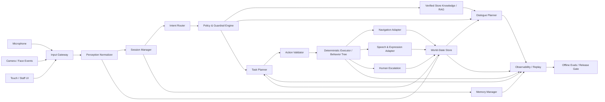

# Target System Architecture

## Hard boundary

The LLM side ends at:
- structured dialogue plan,
- structured intent,
- structured high-level action proposal.

The deterministic side owns:
- capability permission,
- state freshness checks,
- map destination validation,
- collision avoidance,
- path execution,
- timeout/cancel,
- emergency stop,
- arrival verification,
- recovery and escalation.

## Runtime loop

1. Receive timestamped input.
2. Normalize and reject stale/low-quality inputs.
3. Update world state.
4. Determine active session and interrupt policy.
5. Route intent.
6. Apply policy.
7. Retrieve verified business information if needed.
8. Produce compact dialogue and/or action proposal.
9. Validate action against state, capability, policy and safety.
10. Execute deterministically.
11. Verify completion.
12. Recover or escalate.
13. Speak the truthful outcome.
14. Record a trace with prompt/config versions.
